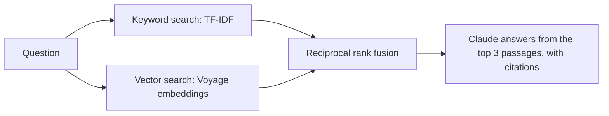

# RAG Knowledge Agent

[](https://github.com/Gramman87/rag-agent/actions/workflows/ci.yml)

Ask a question about a fictional product's documentation. The app finds the most relevant passages, then Claude answers from only those passages and cites them. The page shows each step and the passages it used.

**[Live demo](https://rag-agent-tau.vercel.app)**

## How it works



- **Chunking:** each document splits at paragraphs, since each paragraph covers one topic. That gives 30 passages across 5 documents.
- **Keyword search:** TF-IDF cosine similarity, written from scratch in [`lib/rag.ts`](lib/rag.ts). It's precise when the question uses the documents' words.
- **Vector search:** embeddings from Voyage AI, which match on meaning when the wording differs. A similarity floor lets an off-topic question retrieve nothing instead of its least-bad match.
- **Fusion:** reciprocal rank fusion merges the two lists by position, so their scores never need a common scale.
- **Fallbacks:** without `VOYAGE_API_KEY`, or if Voyage fails, retrieval uses keywords only and the page says so. If Claude is unavailable, the page still shows the passages it found.

## Measuring retrieval

`npm run eval` scores retrieval against 16 hand-written questions in [`evals/cases.ts`](evals/cases.ts). Half reuse the documents' wording. The other half are paraphrases that deliberately avoid it, so they are a stress test, not a typical mix of questions.

| Retrieval | Question type | Hit in top 1 | Hit in top 3 | MRR |
| --- | --- | --- | --- | --- |
| Keyword only | Direct | 100% | 100% | 1.00 |
| Keyword only | Paraphrase | 13% | 13% | 0.16 |

Those keyword scores are why vector search exists here. Hybrid scores appear when you run the eval with `VOYAGE_API_KEY` set.

## Run it

Requires Node 22 or newer.

```bash
npm ci
cp .env.example .env.local   # add your keys
npm run dev
```

Both keys are optional. See the fallbacks above for what changes without them.

## Tests

```bash
npm test
```

Tests cover chunking, keyword ranking, rank fusion, the similarity floor, the fallbacks, and the Voyage request format. They use a fake embedder, so they make no API calls and cost nothing. CI also runs lint, type checks, the keyword eval, and a production build.

Everything in the documents is made up.
